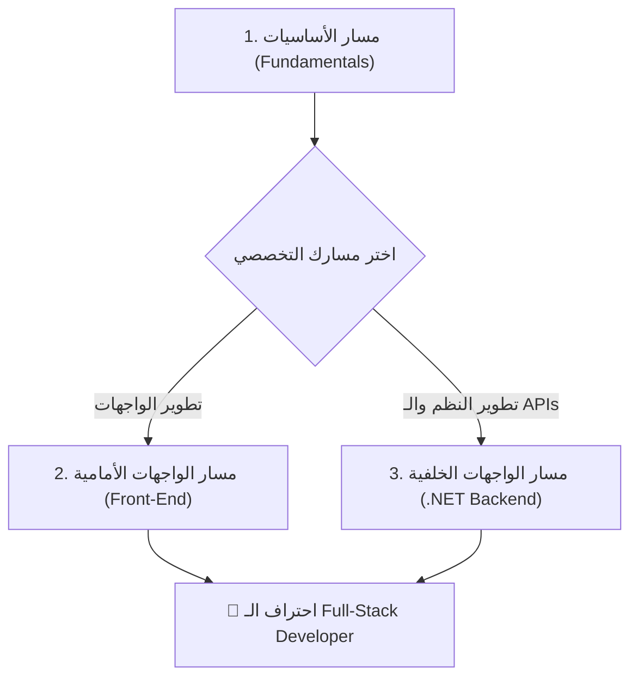

# مسارات تعلم البرمجة والتطوير | Developer Roadmaps 🚀

> **عمل خالص لوجه الله تعالى — صدقة جارية لكل من يريد تعلّم البرمجة واحترافها من الصفر وحتى سوق العمل مجاناً وبلا أي قيود أو اشتراكات.**

[](https://elhendawy-1.github.io/Developer-Roadmaps/)
[](https://github.com/Elhendawy-1/Developer-Roadmaps)
[](https://github.com/Elhendawy-1/Developer-Roadmaps)
[](#)

---

## 🌐 روابط المعاينة المباشرة (Live Demos)

يمكنك تصفح البوابة وجميع المسارات مباشرة عبر متصفحك دون الحاجة لتثبيت أي برامج:

| المسار | الوصف | رابط التصفح المباشر |
| :--- | :--- | :--- |
| 🏠 **البوابة الرئيسية (Hub)** | المدخل الموحد لجميع المسارات والمقارنة بينها | [**فتح البوابة الرئيسية**](https://elhendawy-1.github.io/Developer-Roadmaps/) |
| 💻 **أساسيات البرمجة** | 24 كورساً متكاملاً (C++, خوارزميات، هياكل بيانات، OOP، قواعد بيانات) | [**فتح مسار الأساسيات**](https://elhendawy-1.github.io/Developer-Roadmaps/fundamentals/) |
| 🎨 **الواجهات الأمامية (Front-End)** | من الصفر حتى الجاهزية للوظيفة (HTML, CSS, JS, TS, React) | [**فتح مسار الـ Frontend**](https://elhendawy-1.github.io/Developer-Roadmaps/frontend/) |
| ⚙️ **الواجهات الخلفية (.NET Backend)** | 9 مراحل لاحتراف هندسة الـ APIs والأنظمة بـ C# و ASP.NET Core | [**فتح مسار الـ Backend**](https://elhendawy-1.github.io/Developer-Roadmaps/backend/) |

---

## 📖 نظرة عامة على المحتوى

يجمع هذا المستودع **3 مسارات تعليمية احترافية** تمت هندستها وتنسيقها بعناية فائقة لتكون مرجعك اليومي أثناء رحلة التعلم:

### 1. 💻 مسار أساسيات البرمجة (Programming Fundamentals Roadmap)
- **المنهج:** مبني على سلسلة الـ 24 كورساً للدكتور محمد أبو هدهود.
- **التركيز:**
  - بناء التفكير المنطقي والخوارزمي وحل المشكلات (Problem Solving).
  - إتقان لغة **C++** من الصفر وحتى المفاهيم المتقدمة (Pointers, Memory, OOP).
  - هياكل البيانات (Data Structures) والخوارزميات (Algorithms).
  - قواعد البيانات العلائقية (Relational Databases, SQL Server, T-SQL).
  - مشاريع وأنظمة برمجية حقيقية متكاملة (Bank System, ATM, DVLD System).
- **المميزات:** تتبع التقدم لكل درس، نوافذ منبثقة لقوائم الدروس (Modal)، فلاتر حسب نوع التقنية، وكوبونات خصم للدورات.

### 2. 🎨 مسار مطور الواجهات الأمامية (Front-End Developer Roadmap)
- **المنهج:** مسار عملي متدرج يأخذك من الصفر وحتى الجاهزية لسوق العمل (Zero to Job-Ready) في 6 إلى 9 أشهر.
- **التركيز:**
  - أساسيات الويب (Web Fundamentals, HTTP, Client/Server, DNS).
  - بناء الواجهات المتجاوبة والدلالية بـ **HTML5 & CSS3** (Flexbox, Grid).
  - إتقان **JavaScript (ES6+)** من الأساسيات وحتى الـ Asynchronous JS والـ APIs.
  - إدارة الإصدارات بـ **Git & GitHub**.
  - **TypeScript** مع React.
  - إتقان مكتبة **React 19** (Components, Hooks, React Router, State Management).
  - الاختبارات (Testing بـ Jest و React Testing Library) ومواضيع متقدمة (Next.js, Performance).
- **المميزات:** جدول للمشاريع العملية المتدرجة، دعم الوضع الليلي (Dark Mode)، قائمة بالتصنيفات والمصادر الرسمية الموثوقة.

### 3. ⚙️ مسار مطور الواجهات الخلفية (Backend Developer Roadmap - .NET)
- **المنهج:** 9 مراحل شاملة تضم أكثر من 20 مصدراً موثوقاً لاحتراف تطوير النظم الخلفية ببيئة Microsoft .NET.
- **التركيز:**
  - أساسيات علوم الحاسب ولغة **C#**.
  - البرمجة كائنية التوجه المتقدمة (C# OOP).
  - قواعد البيانات و SQL Server.
  - مبادئ التصميم النظيف **SOLID Principles**.
  - أنماط التصميم المعمارية **Design Patterns**.
  - الاستعلام المتقدم بـ **LINQ**.
  - التعامل مع البيانات بـ **Entity Framework Core (EF Core 8/9)**.
  - هندسة وتأمين واجهات برمجة التطبيقات **ASP.NET Core REST APIs** (Authentication, JWT, Docker, Clean Architecture).
- **المميزات:** شريط الاستمرار التلقائي للمرحلة التالية، خاصية البحث والفلترة الفورية، قائمة بالموارد الأساسية والبدائل المجانية والمدفوعة، وحفظ التقدم بضغطة زر.

---

## 🎯 خطة التعلم المقترحة (Recommended Learning Path)



1. **الخطوة الأولى (ضرورية للجميع):** ابدأ بـ **مسار الأساسيات**؛ فهو يبني عقليتك الرياضية والبرمجية، ويجعلك تفهم كيف يعمل الحاسوب والذاكرة قبل التعامل مع أي إطار عمل.
2. **الخطوة الثانية (التخصص):**
   - إذا كنت تحب بناء الواجهات التفاعلية وتجربة المستخدم، توجه إلى **مسار الـ Front-End**.
   - إذا كنت تحب تصميم قواعد البيانات ومنطق الأعمال وهندسة الـ APIs وحماية الأنظمة، توجه إلى **مسار الـ .NET Backend**.
3. **الخطوة الثالثة (التكامل):** يمكنك الجمع بين المسارين لتصبح مطوراً شاملاً **Full-Stack** قادراً على تسليم تطبيق كامل من الواجهة حتى قاعدة البيانات.

---

## 🎁 كوبونات الدعم والخصم (Coupons)

لدعم إخواننا وأخواتنا الطلاب والمتعلمين، تتضمن مسارات هذا المستودع كوبونات خصم (25%, 50%, 75%, 100%) لدورات م. محمد أبو هدهود:

| نسبة الخصم | كود الكوبون | طريقة الاستخدام |
| :---: | :---: | :--- |
| **25% OFF** | `SUPPORT25%` | متوفر زر نسخ الكود بداخل الصفحة بضغطة واحدة |
| **50% OFF** | `SUPPORT50%` | متوفر زر نسخ الكود بداخل الصفحة بضغطة واحدة |
| **75% OFF** | `SUPPORT75%` | متوفر زر نسخ الكود بداخل الصفحة بضغطة واحدة |
| **100% OFF** | `SUPPORT100%` | متوفر زر نسخ الكود بداخل الصفحة بضغطة واحدة |

*يتم استخدام الكود وقت الدفع على منصة programmingadvices.com.*

---

## 💻 التشغيل المحلي (Run Locally)

لا يحتاج هذا المشروع إلى أي سيرفر، قاعدة بيانات، أو أدوات تثبيت (مثل Node أو Python). كل ما عليك فعله:

1. قم بتنزيل أو استنساخ المستودع:
```bash
git clone https://github.com/Elhendawy-1/Developer-Roadmaps.git
cd Developer-Roadmaps
```

2. افتح ملف `index.html` في متصفحك مباشرة بالضغط المزدوج عليه، أو عبر تشغيل خادم محلي خفيف:
```bash
npx serve .
```

---

## 📁 هيكلية المستودع (Project Structure)

```text
Developer-Roadmaps/
├── index.html                   # البوابة الرئيسية التفاعلية لجميع المسارات
├── README.md                    # هذا الملف التوضيحي الشامل
├── .gitignore                   # ملف استثناء الملفات المؤقتة
│
├── fundamentals/                # مسار أساسيات البرمجة
│   ├── index.html               # تطبيق الويب لمسار الأساسيات
│   └── README.md                # توثيق مسار الأساسيات
│
├── frontend/                    # مسار مطور الواجهات الأمامية
│   ├── index.html               # تطبيق الويب لمسار الواجهات الأمامية
│   └── README.md                # توثيق مسار الـ Front-End
│
└── backend/                     # مسار مطور الواجهات الخلفية
    ├── index.html               # تطبيق الويب لمسار .NET Backend
    └── README.md                # توثيق مسار الـ Backend
```

---

## ✨ مميزات تقنية (Technical Highlights)

- **Pure Vanilla Web Tech:** تم بناء جميع الصفحات بـ HTML5 الدلالي، CSS3 الحديث، وجافاسكربت الصافية دون أي مكتبات خارجية ثقيلة لتضمن سرعة تحميل فائقة وتوافقاً مع كل الأجهزة.
- **تتبع التقدم التلقائي (Local Storage):** يتم حفظ المراحل والدروس التي أكملتها محلياً داخل متصفحك تلقائياً وبأمان، دون الحاجة لإنشاء حساب أو تسجيل دخول.
- **تصميم متجاوب وسلس:** يدعم جميع أحجام الشاشات من الهواتف الذكية (360px) وحتى الشاشات الكبيرة بدقة 4K.
- **جاهز للطباعة والـ Offline:** يمكنك حفظ أي صفحة كـ PDF أو تصفحها محلياً في وضع عدم الاتصال.

---

## 🤲 إهداء ودعاء (Dedication & Credits)

> نسأل الله العظيم أن يتقبل هذا العمل خالصاً لوجهه الكريم، وأن يجعله عِلماً يُنتفَعُ به وصدقةً جاريةً، وأن ينفع به كل طالب علم ومبرمج في أمتنا.
> 
> لا تنسونا من صالح دعائكم بظهر الغيب. 🤍

- **إعداد وتنسيق:** [Elhendawy](https://github.com/Elhendawy-1)
- **محتوى الكورسات المرجعية:** د. محمد أبو هدهود، م. طارق العريفي (Metigator)، م. أسامة الزيرو (Elzero Web School)، وفريق ITI.
- جميع الحقوق الفكرية للكورسات والفيديوهات تعود لأصحابها ومقدميها الأفاضل.
